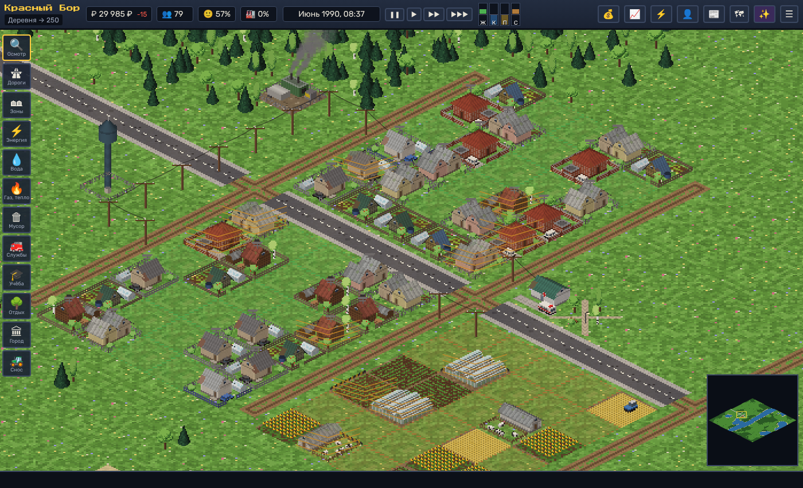
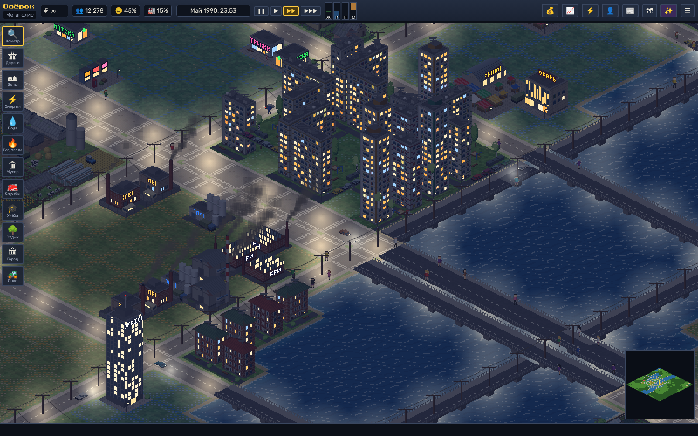

# Trippatroppa — градостроитель 90-х

Пиксельный изометрический градостроитель в браузере: от деревни до мегаполиса. Вдохновлён TeoTown и SimCity, сеттинг — 90-е.

**Играть:** после включения GitHub Pages игра будет доступна по адресу `https://kamazichyo.github.io/Trippatroppa/`.




## Что есть

- **Детальная пиксельная графика** — вся графика рисуется кодом: изометрический растеризатор с освещением граней, ~100 типов зданий (избы, хрущёвки, панельки, сталинки, ларьки, рынки, заводы, АЭС, водонапорная башня Рожновского, церковь с куполами, телебашня...), у каждого несколько вариантов.
- **День и ночь** — свет в окнах, неоновые вывески, фонари, фары машин. **Зима** — снег на крышах и земле, снегопад; весной и осенью — дожди.
- **Ресурсы и коммуникации** — электричество (ЛЭП), вода, газ, отопление (сезонное!), канализация, вывоз мусора. Каждое здание потребляет и производит свои ресурсы; частные дома топят печи и используют септики, а многоэтажкам нужны котельная и канализация.
- **Зоны RCI + сельхоз** трёх плотностей, спрос, стоимость земли, загрязнение, шум, преступность, покрытие служб.
- **Живые жители** — у каждого имя, возраст, профессия, дом, работа и распорядок дня: утром едут на работу (пешком, на своей машине или автобусе), обедают в кафе, после работы ходят по магазинам, в парк, в кино, дети идут в школу, пенсионеры — на рынок и к врачу. Можно щёлкнуть по любому жителю и следить за ним.
- **Служебный транспорт** — пожарные выезжают на пожары, патрули милиции, мусоровозы, скорые, автобусы, фуры с товарами с трассы.
- **Экономика** — налоги, финансирование служб, торговля товарами и едой, закупка газа, кредиты под 25% годовых, события 90-х (либерализация цен, ваучеры, дефолт 98-го).
- **Прогрессия** — Деревня → Село → Посёлок → Городок → Город → Крупный город → Мегаполис, с открытием новых зданий.
- **Бедствия** — пожары, торнадо, землетрясение, метеорит.
- **Меню бога** ✨ — бесконечные деньги, мгновенная стройка, открыть всё, управление временем суток и погодой, застройка всех зон, стихии, терраформинг.
- Сохранение в браузере, экспорт/импорт файла, мини-карта, информационные слои, статистика с графиками.

## Управление

| Действие | Мышь / клавиши | Тач |
|---|---|---|
| Действие инструментом | ЛКМ, протянуть для линий/областей | палец |
| Сдвиг карты | ПКМ / перетаскивание инструментом «Осмотр», WASD / стрелки | два пальца |
| Масштаб | колесо, `+` / `-` | щипок |
| Пауза / скорость | Пробел, `1`–`3` | кнопки сверху |
| Бульдозер / дорога / меню бога | `B` / `R` / `G` | — |

## Запуск локально

Сборка не нужна — это чистый JavaScript (ES-модули):

```bash
python3 -m http.server 8000
# открыть http://localhost:8000
```

Галерея всех спрайтов: `dev/gallery.html` (параметры `?scale=3&night&only=r3`).

## Публикация на GitHub Pages

В репозитории есть workflow `.github/workflows/pages.yml`. Включите Pages: **Settings → Pages → Source: GitHub Actions**. После каждого пуша в `master` игра обновится автоматически.

## Структура

```
js/engine   — растеризатор, утилиты, пиксельный шрифт
js/gfx      — спрайты: здания, деревья, машины, люди, тайлы земли
js/data     — описания зданий, ресурсов, имена, улицы, новости
js/game     — мир, сети, рост, экономика, жители, бедствия
js/render   — отрисовка (глубина, ночь, частицы, слои)
js/ui       — интерфейс и управление
```
